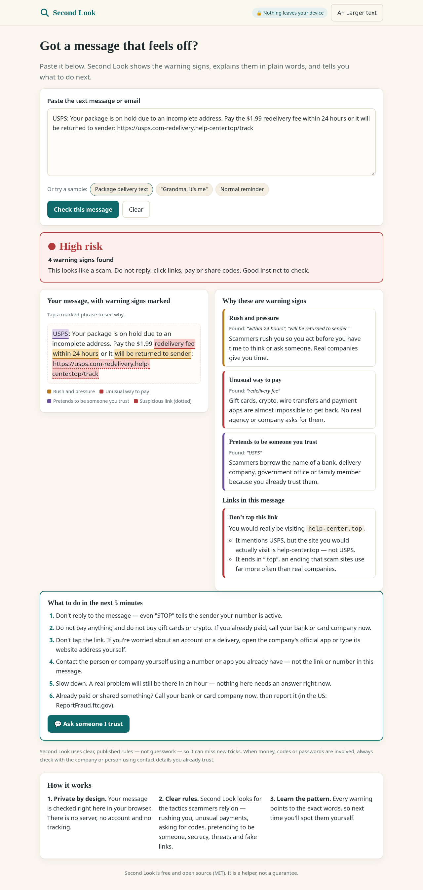
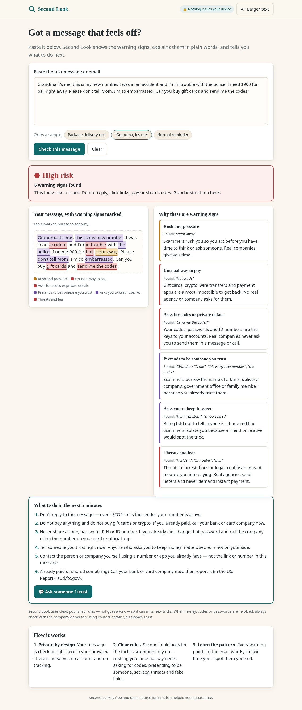
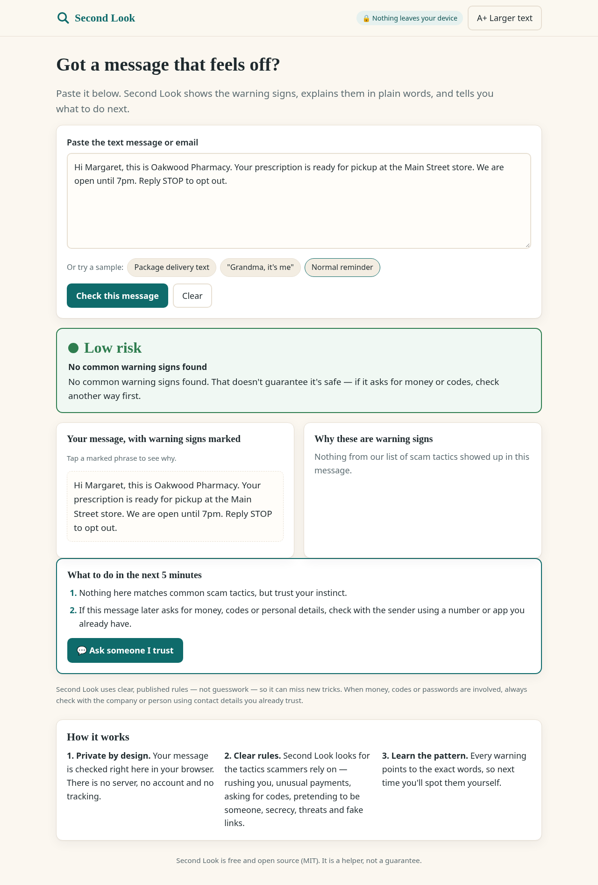
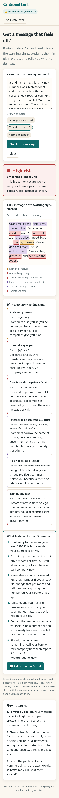

# Second Look 🔍

**A calm, private second opinion on suspicious messages.**
Paste a strange text or email. Second Look highlights the exact words that are classic scam tactics, explains each one in plain language, checks where links *really* go, and tells you what to do in the next 5 minutes — all inside your browser. Nothing is uploaded.

**Live demo:** https://jackzhu88.github.io/second-look/ · **Video:** https://vimeo.com/1239016518



## Why
Scam texts and emails ("your package is on hold, pay $1.99", "Grandma, it's me, don't tell Mom") cost people billions every year, and older adults lose the most per incident. The usual advice — "be careful" — doesn't help in the moment. What helps is a patient friend who reads the message with you and points at the tricks. Second Look is that friend, available from a link, for free, without anyone reading your messages.

## What it does
- **Verdict at a glance** — Low risk / Be careful / High risk, with the number of warning signs and one sentence of advice.
- **Highlights the exact words** — color-coded by tactic: rush and pressure, unusual ways to pay (gift cards, crypto, wire), requests for codes or passwords, impersonation, too good to be true, secrecy, threats. Tap a highlight to jump to its explanation.
- **Link check** — spells out the site you would *really* visit and why it looks fake: a fake website name glued to the front of a different site (`postal-service.com-redelivery.help-center.top`), look-alike spelling (`paypa1.com`, `arnazon.com`), punycode, bare IP addresses, shortened links, the `@` trick, scam-heavy endings like `.top`.
- **What to do in the next 5 minutes** — steps tailored to what was found, always ending with what to do if you already paid.
- **Ask someone I trust** — copies a ready-to-send note (verdict + reasons + the message) to paste to a family member.
- **Larger text** toggle (remembered), keyboard friendly, screen-reader live verdict, works on phones.
- **Private by design** — no server, no account, no analytics, no AI API. The rules are open and readable in [`src/rules.js`](src/rules.js).

| Grandparent scam | Normal message stays calm | Phone |
|---|---|---|
|  |  |  |

## Run it locally
No install, no build. You need any modern browser (and Python or Node just to serve files, because ES modules don't load from `file://`).

```bash
git clone https://github.com/jackzhu88/second-look.git
cd second-look
python3 -m http.server 8000     # or: npx serve .
# open http://localhost:8000
```

Run the tests (Node.js 18+; no dependencies):

```bash
node --test
```

## How it works
```
index.html ── src/app.js ──► src/rules.js
 (page)       (renders)       analyze(text) → { level, findings, phrases, links, steps }
                              ├─ TACTICS: phrase patterns + plain-language "why" + next step
                              ├─ inspectLink(): real site, look-alikes, odd endings, tricks
                              └─ nextSteps() / buildTrustedNote()
```
User text is only ever inserted as text nodes (never `innerHTML`), so pasted HTML can't run. A visual map of the code is in [`devpost/app-map.html`](devpost/app-map.html).

**Limits, honestly:** it's rule-based, English-only, and can miss brand-new wording. It never says "safe" — a low result always comes with "check another way if it asks for money or codes".

## How it was built — with the Devpost Skill Pack
Built for **Build With AI: Basics** using the [Devpost Skill Pack](https://github.com/challengepost/learn-ai-basics) (`1-start` → `6-ship`) with an AI coding agent. Planning came first and lives in the repo:

- [`devpost/scope.md`](devpost/scope.md) — the unique kernel, who it's for, what was cut and why
- [`devpost/prd.md`](devpost/prd.md) — core journey and acceptance criteria
- [`devpost/spec.md`](devpost/spec.md) — architecture, data shape, failure modes
- [`devpost/checklist.md`](devpost/checklist.md) — four vertical slices, each verified and committed

Full write-up: [`docs/SKILL_PACK_LOG.md`](docs/SKILL_PACK_LOG.md).

## Roadmap
Screenshot input with on-device OCR · more languages · "share to Second Look" from the phone's share sheet · a practice mode that teaches the tactics with real-world examples.

## License
[MIT](LICENSE) © 2026 jackzhu88
